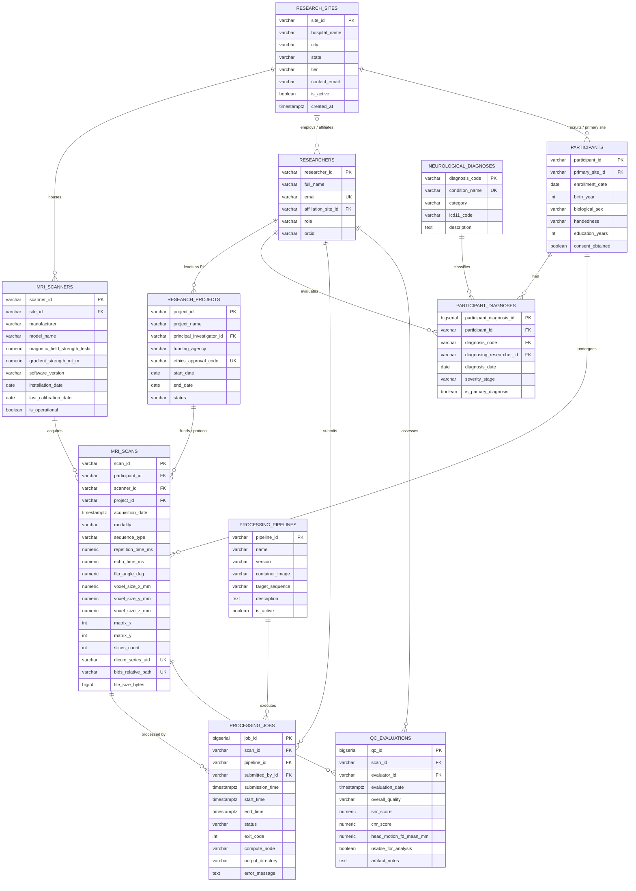

# Portfolio 1: Database Design and Modelling

**Course:** MIT 8103 – Advanced Database Systems  
**Programme:** Master of Information Technology  
**Institution:** Miva Open University  
**Student:** Patrick Filima  
**Academic Session:** 2026/2027  
**Cohort:** September 2026  

---

## 1. Case Study Overview: African Neuroimaging Research Data Management System (ANRDMS)

### 1.1 Context and Problem Domain
Neuroimaging research generates multi-modal, high-dimensional datasets including magnetic resonance imaging (MRI) scans, scanner calibrations, clinical diagnoses, demographic profiles, and computational derivative outputs. In developing research ecosystems such as Nigeria, neuroimaging studies are frequently conducted across geographically dispersed tertiary hospitals:
* **Lagos University Teaching Hospital (LUTH)**, Lagos State
* **National Hospital Abuja (NHA)**, Federal Capital Territory
* **University College Hospital (UCH)**, Ibadan, Oyo State
* **University of Nigeria Teaching Hospital (UNTH)**, Enugu State
* **Ahmadu Bello University Teaching Hospital (ABUTH)**, Zaria, Kaduna State

Prior to this system, imaging metadata and participant records were typically captured through fragmented spreadsheets and localized scanner archives. This decentralized practice introduces severe operational risks:
1. **Data Inconsistency:** Differing naming conventions for pulse sequences (`T1w`, `MPRAGE`, `3D-T1`) and diagnostic classifications.
2. **Loss of Provenance:** Inability to reliably track which specific MRI scanner, head coil, and software version acquired a given image.
3. **Computational Bottlenecks:** Difficulties in synchronizing batch image-processing jobs (e.g., FreeSurfer cortical reconstruction, FSL brain extraction) with raw scan acquisitions.
4. **Ethical and Regulatory Non-compliance:** Risks of managing participant records without centralized verification of informed consent and Institutional Review Board (IRB/NHREC) ethics protocols.

The **African Neuroimaging Research Data Management System (ANRDMS)** is a specialized relational database platform designed to unify participant demographics, multi-site hardware tracking, clinical neurological diagnoses, Brain Imaging Data Structure (BIDS) file provenance, compute jobs, and radiologist quality control (QC).

---

## 2. Stakeholders and User Personas

| User Role | Key Responsibilities | Primary Database Operations |
| :--- | :--- | :--- |
| **Principal Investigators (PIs)** | Manage research grants, clinical trial ethics approvals, and multi-site cohorts. | Create projects, monitor participant recruitment, track overall study progress. |
| **Radiologists & Neurologists** | Evaluate MRI scans, confirm clinical diagnoses (ICD-11), and assign severity stages. | Record clinical diagnoses, conduct visual quality control reviews, flag imaging artifacts. |
| **Neuroimaging Analysts** | Execute computational pipelines (FreeSurfer, QSIPrep, fMRIPrep) on high-performance compute clusters. | Query candidate scans by sequence/field strength, dispatch batch processing jobs, inspect QC scores. |
| **Data Managers** | Maintain data dictionary standards, verify ethical consent, ensure BIDS compliance. | Register research sites, audit scanner calibrations, monitor data completeness. |
| **Database Administrators (DBAs)** | Ensure high availability, transaction integrity, indexing performance, and backup policies. | Optimize execution plans, monitor concurrent lock contention, manage replication topologies. |

---

## 3. Entity-Relationship (ER) Diagram

The ANRDMS relational model comprises **11 interconnected entities** designed to Boyce-Codd Normal Form (BCNF):



---

## 4. Relational Schema & Constraint Architecture

The database schema is implemented in PostgreSQL 14+ via [`schema.sql`](./schema.sql). The design enforces rigorous database integrity constraints:

### 4.1 Key Constraints & Cardinalities
1. **Entity Integrity (Primary Keys):** Every table possesses an unambiguous primary key (`site_id`, `scanner_id`, `participant_id`, `scan_id`, or surrogate `BIGSERIAL` identifiers for high-volume execution logs like `job_id` and `qc_id`).
2. **Referential Integrity (Foreign Keys):**
   * `ON DELETE RESTRICT` protects core master entities (sites, scanners, participants, projects) from accidental cascading deletion.
   * `ON DELETE CASCADE` is reserved for dependent associative and derivative tables (`participant_diagnoses`, `processing_jobs`, `qc_evaluations`), ensuring that if a corrupted scan record is expunged, its child jobs and QC ratings are cleanly removed without leaving orphan records.
3. **Domain & Check Constraints:**
   * **Physics & Protocol Checks:** $TR > 0$, $TE > 0$, $0^\circ < \text{flip\_angle} \le 180^\circ$, positive voxel dimensions.
   * **Magnetic Field Strengths:** Restricted to clinical and research standards: $B_0 \in \{0.3, 1.5, 3.0, 7.0\}\text{ Tesla}$ (accommodating low-field Nigerian scanners through 7T research magnets).
   * **Ethical Guardrails:** `CHECK (consent_obtained IS TRUE)` with no default assumption (must be explicitly attested by researcher).
   * **Chronological Integrity:** Enforces `end_time >= start_time >= submission_time` for computational batch jobs.
4. **Unique Constraints:**
   * `dicom_series_uid`: Guarantees international medical uniqueness of DICOM series.
   * `bids_relative_path`: Enforces Brain Imaging Data Structure directory uniqueness on disk.
   * `uq_participant_diagnosis`: Prevents accidental duplicate assignment of the same diagnostic code to a participant.

---

## 5. Summary of Database Normalisation

The relational schema was developed by decomposing a flat unnormalised scanner acquisition spreadsheet (`UNF`) through successive mathematical normal forms:

* **1NF:** Flattened multi-valued repeating groups (multiple diagnoses, pulse sequences, and software runs) into atomic scalar attributes and established composite candidate keys.
* **2NF:** Removed partial dependencies where non-prime attributes depended on a subset of composite candidate keys (e.g., isolating participant demographics from composite scan/diagnosis keys).
* **3NF:** Removed transitive dependencies ($X \to Y \to Z$), such as scanner hardware properties depending transitively on `scan_id` via `scanner_id`, and hospital address attributes depending on `participant_id` via `site_id`.
* **BCNF:** Audited every functional dependency $X \to Y$ to prove that determinant $X$ is strictly a superkey across all 11 relations.

> [!NOTE]
> For the comprehensive mathematical treatise, formal functional dependency proofs, closure calculations, and lossless-join theorems, please refer to the dedicated [`normalisation_report.md`](./normalisation_report.md).

---

## 6. Implementation & Verification Guide

### 6.1 Database Setup (PostgreSQL)

To create the database and populate the synthetic research dataset:

```bash
# 1. Connect to PostgreSQL and create the portfolio database
psql -d postgres -c "CREATE DATABASE anrdms;"

# 2. Execute the schema DDL script to generate tables and constraints
psql -d anrdms -v ON_ERROR_STOP=1 -f portfolio-1-database-design/schema.sql

# 3. Populate the database with synthetic neuroimaging research records
psql -d anrdms -v ON_ERROR_STOP=1 -f portfolio-1-database-design/seed_data.sql
```

### 6.2 Verification Queries & Live Execution Results

Executing the table verification query confirms all 11 tables and their exact record counts in the live database:

```sql
SELECT 
    'research_sites' AS table_name, count(*) AS record_count FROM research_sites UNION ALL
SELECT 'mri_scanners', count(*) FROM mri_scanners UNION ALL
SELECT 'researchers', count(*) FROM researchers UNION ALL
SELECT 'research_projects', count(*) FROM research_projects UNION ALL
SELECT 'participants', count(*) FROM participants UNION ALL
SELECT 'neurological_diagnoses', count(*) FROM neurological_diagnoses UNION ALL
SELECT 'participant_diagnoses', count(*) FROM participant_diagnoses UNION ALL
SELECT 'mri_scans', count(*) FROM mri_scans UNION ALL
SELECT 'processing_pipelines', count(*) FROM processing_pipelines UNION ALL
SELECT 'processing_jobs', count(*) FROM processing_jobs UNION ALL
SELECT 'qc_evaluations', count(*) FROM qc_evaluations;
```

**Live Verified Database Results:**
| Table Name | Record Count | Description |
| :--- | :--- | :--- |
| `research_sites` | 5 | Multi-site hospital centres (Lagos, Abuja, Ibadan, Enugu, Zaria) |
| `mri_scanners` | 6 | 1.5T & 3.0T MRI systems (Siemens, GE, Philips) |
| `researchers` | 8 | PIs, Radiologists, Analysts, Data Managers |
| `research_projects` | 4 | Multi-site grant protocols (ABHI, WASCS, SSADG, NPEPP) |
| `participants` | 25 | Synthetic participant demographic & consent records |
| `neurological_diagnoses` | 7 | Clinical ICD-11 neurological conditions & healthy control |
| `participant_diagnoses` | 25 | Patient-diagnosis mapping with clinical severity |
| `mri_scans` | 36 | Pulse sequence acquisitions (T1w, FLAIR, dMRI, fMRI) |
| `processing_pipelines` | 5 | Neuroinformatics software containers (FreeSurfer, FSL, etc.) |
| `processing_jobs` | 23 | Computational batch processing execution logs |
| `qc_evaluations` | 20 | Quantitative image quality metrics (SNR, CNR, FD motion) |

> [!NOTE]
> For complete terminal transcripts, execution logs, and empirical constraint violation tests (CHECK, FK, UNIQUE, and Consent guardrails), see [`verification_evidence.md`](./verification_evidence.md).

---

## 7. Portfolio Artifact Manifest

* [`schema.sql`](./schema.sql): Complete PostgreSQL DDL schema definition script with comments, constraints, and indexes.
* [`seed_data.sql`](./seed_data.sql): Synthetic data script populating 11 tables with realistic multi-site Nigerian neuroimaging records.
* [`er_diagram.mermaid`](./er_diagram.mermaid): Standalone Mermaid source code for the Entity-Relationship Diagram.
* [`data_dictionary.md`](./data_dictionary.md): Field-by-field specifications of attributes, domains, keys, and descriptions.
* [`normalisation_report.md`](./normalisation_report.md): Formal academic normalisation analysis (UNF through BCNF) with anomaly proofs and lossless-join guarantees.
* [`verification_evidence.md`](./verification_evidence.md): Empirical test output, table catalogs, row count audits, and constraint violation proofs.
