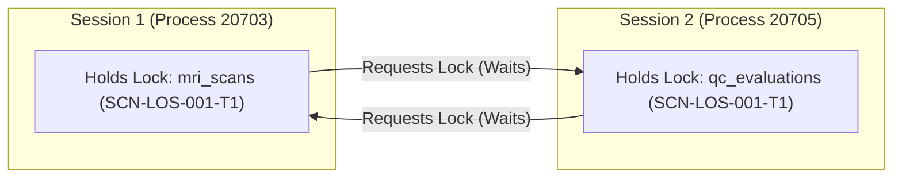

# Portfolio 3: Transactions and Concurrency Analysis

**Course:** MIT 8103 – Advanced Database Systems  
**Institution:** Miva Open University  
**Student:** Patrick Filima  
**System:** African Neuroimaging Research Data Management System (ANRDMS)  
**Database Engine:** PostgreSQL 16.16 (Homebrew, aarch64-apple-darwin)  
**Dedicated Test Database:** `anrdms_transactions`  
**Weighting:** 7 Marks  

---

## 1. Executive Summary

In multi-site medical research systems, database transaction management is a critical clinical, ethical, and computational prerequisite. The **African Neuroimaging Research Data Management System (ANRDMS)** coordinates neuroimaging acquisition, radiological quality control (QC), and distributed High-Performance Computing (HPC) feature extraction across five tertiary teaching hospitals in Nigeria (LUTH, NHA, UCH, UNTH, and ABUTH).

This report presents the empirical verification and theoretical analysis for **Portfolio 3: Transactions and Concurrency**. To preserve the baseline dataset from Portfolio 1 and maintain the reproducibility of Portfolio 2 query optimization benchmarks, all experiments were executed in a dedicated, isolated database named `anrdms_transactions`.

### Key Technical Contributions:
1. **ACID Properties in Clinical Neuroinformatics:** Practical demonstration of Atomicity, Consistency, Isolation, and Durability across multi-table imaging workflows, including zero-orphan rollbacks and fine-grained `SAVEPOINT` fault recovery.
2. **PostgreSQL Multi-Version Concurrency Control (MVCC):** Storage-level inspection of tuple headers (`xmin`, `xmax`, `ctid`), demonstrating physical non-overwriting tuple versioning and Write-Ahead Logging (WAL) write and flush alignment.
3. **ANSI Isolation Level Verification:** Empirical reproduction and resolution of concurrency phenomena: row-level and aggregate **Non-Repeatable Reads** under `READ COMMITTED`, snapshot preservation under `REPEATABLE READ`, and **Write Skew** detection under Serializable Snapshot Isolation (`SERIALIZABLE`, SQLSTATE `40001`).
4. **Pessimistic Concurrency & High-Throughput Queueing:** Implementation of row-level locking (`SELECT ... FOR UPDATE`) to prevent lost updates, alongside non-blocking worker queue dispatch (`FOR UPDATE SKIP LOCKED`) for distributed imaging nodes.
5. **Deadlock Detection & Resolution:** Interleaved cross-table updates generating a wait-for graph cycle, automated cycle resolution by the PostgreSQL Lock Manager via `deadlock_timeout` (SQLSTATE `40P01`), and application retry patterns with jittered exponential backoff.
6. **Automated Verification Harness:** A portable, cross-platform Python test harness ([`run_concurrency_tests.py`](./run_concurrency_tests.py)) that drives parallel interactive sessions and automatically asserts expected database outcomes.

---

## 2. Theoretical Framework: ACID Properties in ANRDMS

Relational database systems guarantee reliable processing of database operations through the ACID paradigm (Haerder & Reuter, 1983). In ANRDMS, these theoretical principles map directly to neuroimaging integrity requirements:

```
+---------------------------------------------------------------------------------------------------------+
|                                    ANRDMS TRANSACTION BOUNDARY                                          |
|                                                                                                         |
|  [Participants] ---------> [Participant Diagnoses] ---------> [MRI Scans] ---------> [QC Evaluations]   |
|   (Demographics)                (Clinical DX)                   (DICOM/BIDS)              (SNR / Motion)        |
|                                                                                                         |
|       * ATOMICITY: All 4 entities commit together, or none persist (Zero Orphan Guarantee).              |
|       * CONSISTENCY: Enforces 65 schema constraints (e.g. TR > 0, consent = TRUE, foreign keys).         |
|       * ISOLATION: MVCC snapshots prevent dirty reads and uncommitted clinical contamination.           |
|       * DURABILITY: Write-Ahead Log (WAL) flushed to non-volatile disk before COMMIT acknowledges.      |
+---------------------------------------------------------------------------------------------------------+
```

### 2.1 Atomicity
A clinical intake protocol requires the concurrent generation of multiple relational records. If an investigator enrolls a research subject, records a baseline diagnosis, and enters an initial MRI scan, a failure during the scan registration (e.g., duplicate DICOM UID or an out-of-range pulse sequence parameter) must not leave behind an orphaned participant or an unattached diagnosis. Atomicity guarantees that all state transitions within a `BEGIN ... COMMIT` block succeed completely or abort cleanly via `ROLLBACK`.

### 2.2 Consistency
Consistency ensures that the database transitions strictly between valid relational states. Every transaction in ANRDMS must satisfy the 65 schema constraints established in Portfolio 1:
- **Entity & Referential Integrity:** Foreign keys from scans to participants, scanners, and projects (`ON DELETE RESTRICT`).
- **Domain Constraints:** Repetition times must be strictly positive (`ck_scans_tr: repetition_time_ms > 0`), scanner magnetic field strengths must match validated hardware (`ck_scanners_field_strength: 0.3T, 1.5T, 3.0T, 7.0T`).
- **Ethical Integrity:** `ck_participants_consent` explicitly requires `consent_obtained IS TRUE`.

### 2.3 Isolation
When dozens of neuroimaging researchers, radiologists, and automated HPC compute daemons access ANRDMS concurrently, uncommitted transactions must not interfere with one another. Isolation guarantees that intermediate, uncommitted updates remain invisible to other concurrent sessions, preventing clinical misdiagnoses resulting from reading partial or unverified records.

### 2.4 Durability
Once an imaging session or QC evaluation is committed, its persistence is guaranteed even in the event of an unexpected hardware crash, power outage, or operating system panic. PostgreSQL guarantees durability via **Write-Ahead Logging (WAL)**: data page modifications are sequentially written and flushed to the active WAL segment (`pg_wal`) on physical disk before the `COMMIT` acknowledgement is returned to the client application (`synchronous_commit = on`).

> [!NOTE]
> **Durability Methodology Scope:** Inspecting the WAL insert, write, and flush LSNs demonstrates active WAL generation and verifies that PostgreSQL's flush protocol executed before transaction completion. It does not, by itself, empirically prove survivability across an unannounced physical power loss; that would require dedicated crash-simulation or power-interruption fault-injection experiments.

---

## 3. Practical Transaction Demonstrations & Evaluation

The transaction experiments implemented in [`transactions.sql`](./transactions.sql) demonstrate the transactional life cycle under controlled clinical scenarios.

### 3.1 Transaction 1: Multi-Table Atomic Commit (Atomicity & Consistency)

#### Scenario
A 58-year-old male patient presents with acute right hemiparesis at Lagos University Teaching Hospital (LUTH). Under clinical protocol `PRJ-WASCS-2024` (West African Stroke Cohort Study), an urgent baseline T1w MPRAGE scan is acquired on the 3.0T Skyra scanner (`SCN-LOS-3T01`). The registration pipeline executes an atomic four-table transaction:

```sql
BEGIN TRANSACTION ISOLATION LEVEL READ COMMITTED;

-- 1. Demographics
INSERT INTO participants (participant_id, primary_site_id, enrollment_date, birth_year, biological_sex, handedness, education_years, consent_obtained)
VALUES ('ANRDMS-LOS-006', 'SITE-LOS-01', '2026-11-14', 1968, 'Male', 'Right', 16, TRUE);

-- 2. Clinical Diagnosis
INSERT INTO participant_diagnoses (participant_id, diagnosis_code, diagnosing_researcher_id, diagnosis_date, severity_stage, is_primary_diagnosis, clinical_notes)
VALUES ('ANRDMS-LOS-006', 'DX-STR-001', 'RES-002', '2026-11-14', 'Moderate', TRUE, 'Acute onset right hemiparesis. Urgent baseline MRI.');

-- 3. High-Resolution Scan Acquisition
INSERT INTO mri_scans (scan_id, participant_id, scanner_id, project_id, acquisition_date, modality, sequence_type, repetition_time_ms, echo_time_ms, flip_angle_deg, voxel_size_x_mm, voxel_size_y_mm, voxel_size_z_mm, matrix_x, matrix_y, slices_count, dicom_series_uid, bids_relative_path, file_size_bytes)
VALUES ('SCN-LOS-006-T1', 'ANRDMS-LOS-006', 'SCN-LOS-3T01', 'PRJ-WASCS-2024', '2026-11-14 10:15:00+01', 'MRI', 'T1w', 2300.00, 2.98, 9.0, 1.00, 1.00, 1.00, 256, 256, 176, '1.3.12.2.1107.5.2.32.45123.20261114.1001.001', 'sub-LOS006/ses-01/anat/sub-LOS006_ses-01_T1w.nii.gz', 25482310);

-- 4. Baseline Quality Control
INSERT INTO qc_evaluations (scan_id, evaluator_id, evaluation_date, overall_quality, snr_score, cnr_score, head_motion_fd_mean_mm, usable_for_analysis, artifact_notes)
VALUES ('SCN-LOS-006-T1', 'RES-002', '2026-11-14 11:30:00+01', 'PASS', 19.85, 8.42, 0.115, TRUE, 'Excellent structural grey/white matter contrast; minimal motion.');

COMMIT;
```

#### Empirical Result
As documented in [`evidence/transaction_outputs.txt`](./evidence/transaction_outputs.txt), each individual statement executed with measured timing (demographics insert: 2.52 ms; diagnosis insert: 1.40 ms; scan insert: 10.01 ms; QC insert: 1.18 ms; final COMMIT: 1.02 ms). A four-table join verification confirmed that all four records materialized simultaneously:

| participant_id | biological_sex | birth_year | diagnosis_code | severity_stage | scan_id | sequence_type | overall_quality | snr_score |
| :--- | :--- | :--- | :--- | :--- | :--- | :--- | :--- | :--- |
| **ANRDMS-LOS-006** | Male | 1968 | DX-STR-001 | Moderate | SCN-LOS-006-T1 | T1w | PASS | 19.85 |

---

### 3.2 Transaction 2: Constraint-Enforced Rollback (Zero Orphan Guarantee)

#### Scenario
An intake coordinator attempts to enroll participant `ANRDMS-LOS-007`. The demographic and diagnosis inserts execute without syntax error. However, during the scan record insertion, an inverted gradient polarity generates an invalid negative repetition time (`repetition_time_ms = -2300.00`), directly violating check constraint `ck_scans_tr`.

#### Empirical Engine Response
PostgreSQL immediately threw an exception and placed the transaction block into an aborted state:
```
psql:transactions.sql:271: ERROR:  new row for relation "mri_scans" violates check constraint "ck_scans_tr"
DETAIL:  Failing row contains (SCN-LOS-007-T1, ANRDMS-LOS-007, SCN-LOS-3T01, PRJ-WASCS-2024, ..., -2300.00, ...).
```
Upon receiving the failure, an explicit `ROLLBACK;` was issued. An immediate database audit was performed to verify whether any residual records remained:

```sql
SELECT 'participants' AS table_name, count(*) AS remaining_orphans FROM participants WHERE participant_id = 'ANRDMS-LOS-007'
UNION ALL
SELECT 'participant_diagnoses', count(*) FROM participant_diagnoses WHERE participant_id = 'ANRDMS-LOS-007'
UNION ALL
SELECT 'mri_scans', count(*) FROM mri_scans WHERE participant_id = 'ANRDMS-LOS-007';
```

#### Audit Output
```
      table_name       | remaining_orphans 
-----------------------+-------------------
 participants          |                 0
 participant_diagnoses |                 0
 mri_scans             |                 0
(3 rows)
```
**Evaluation:** Atomicity was strictly maintained. Despite two preceding DML statements completing successfully within the session, the failure of the third statement prevented any partial clinical data from contaminating the database. Zero orphan records persisted.

---

### 3.3 Transaction 3: Nested Savepoints and Fault Recovery (`SAVEPOINT`)

#### Scenario
In automated ingestion pipelines, clinical scan registration should not be aborted simply because an asynchronous downstream compute task encounters a transient error. During the intake of participant `ANRDMS-LOS-008`, the demographic and scan records are inserted successfully. The pipeline creates a savepoint (`SAVEPOINT sp_scan_registered`), then attempts to dispatch an automated FreeSurfer job (`processing_jobs`) with an unsupported status (`QUEUED_FOR_EXECUTION`), violating check constraint `ck_jobs_status`.

```
[BEGIN TRANSACTION]
        |
        v
[Insert Participant ANRDMS-LOS-008]
        |
        v
[Insert Scan SCN-LOS-008-T1]
        |
        v
==================================================
SAVEPOINT sp_scan_registered;  <-------------------+ (Rollback Target)
================================================== |
        |                                          |
        v                                          |
[Insert Job with status = 'QUEUED_FOR_EXECUTION']  |
        |                                          |
        v (FAILS: violates ck_jobs_status)         |
  [ERROR Raised]                                   |
        |                                          |
        +-----> ROLLBACK TO SAVEPOINT sp_scan_registered;
        |
        v
[Insert Job with valid status = 'PENDING']
        |
        v
    [COMMIT]
```

#### Empirical Engine Response
1. The invalid job insertion threw: `ERROR: new row for relation "processing_jobs" violates check constraint "ck_jobs_status"`.
2. The transaction remained viable because the application invoked:
   ```sql
   ROLLBACK TO SAVEPOINT sp_scan_registered;
   ```
3. A corrected job record with valid status `'PENDING'` was inserted and committed.
4. Final verification confirmed that participant `ANRDMS-LOS-008`, scan `SCN-LOS-008-T1`, and job ID `25` (status `'PENDING'`) were successfully preserved in the database.

**Evaluation:** Savepoints provide hierarchical transaction management. By segmenting the transaction, the clinical research system achieved resilience against downstream application errors without sacrificing atomicity.

---

### 3.4 Transaction 4: Physical MVCC Tuple Inspection & Durability Configuration

To examine how PostgreSQL handles concurrent modifications without locking readers, we queried the internal system attributes of row `ANRDMS-LOS-006` before, during, and after an update.

> [!NOTE]
> Physical tuple locations (`ctid`) and transaction identifiers (`xmin`/`xmax`) depend on prior table modifications and database activity. The values reported below correspond to the execution recorded in [`evidence/transaction_outputs.txt`](./evidence/transaction_outputs.txt).

```sql
SELECT participant_id, handedness, education_years,
       xmin::text AS inserting_xid,
       xmax::text AS deleting_updating_xid,
       ctid AS physical_pointer
FROM participants
WHERE participant_id = 'ANRDMS-LOS-006';
```

#### Physical State Transitions
```
1. Initial State (Pre-Update):
   inserting_xid (xmin) = 1092 | deleting_updating_xid (xmax) = 1092 | physical_pointer (ctid) = (0, 26)

2. Inside Transaction (txid_current = 1096, Uncommitted Update):
   inserting_xid (xmin) = 1096 | deleting_updating_xid (xmax) = 0    | physical_pointer (ctid) = (0, 29)

3. Post-Commit State:
   inserting_xid (xmin) = 1096 | deleting_updating_xid (xmax) = 0    | physical_pointer (ctid) = (0, 29)
```

#### Durability Configuration and WAL Flush Evidence
In `transactions.sql`, we verified the engine's durability parameters and compared the WAL write versus flush positions:

```sql
SHOW synchronous_commit; -- Returned: on
SHOW fsync;              -- Returned: on

SELECT 
    pg_current_wal_insert_lsn() AS wal_insert_lsn,
    pg_current_wal_lsn() AS wal_write_lsn,
    pg_current_wal_flush_lsn() AS wal_flush_lsn,
    pg_walfile_name(pg_current_wal_lsn()) AS active_wal_segment_file;
```

Recorded Output:
```
 wal_insert_lsn | wal_write_lsn | wal_flush_lsn | active_wal_segment_file  
----------------+---------------+---------------+--------------------------
 0/F1813F0      | 0/F1813F0     | 0/F1813F0     | 00000001000000000000000F
```

#### Technical Analysis
1. **Physical Non-Overwrite:** The update of `handedness` from `'Right'` to `'Ambidextrous'` did **not** overwrite bytes in place on disk block 0. Instead, PostgreSQL allocated a new physical tuple at slot `(0, 29)`.
2. **Version Chaining:** The original tuple at slot `(0, 26)` was superseded, pointing to `(0, 29)`. Concurrent transactions whose snapshot predated transaction `1096` continue reading slot `(0, 26)` without waiting or blocking.
3. **Synchronous Flush Verification:** The equality `wal_insert_lsn == wal_write_lsn == wal_flush_lsn` (`0/F1813F0`) confirms that PostgreSQL actively wrote and flushed WAL buffers to non-volatile disk storage before acknowledging the commit, satisfying the synchronous commit contract.

---

## 4. Concurrency Control & Isolation Level Analysis

### 4.1 ANSI SQL Isolation Levels vs. PostgreSQL Engine Architecture

The ANSI/ISO SQL-92 standard defines four transaction isolation levels in terms of three operational phenomena: Dirty Read, Non-Repeatable Read, and Phantom Read (Berenson et al., 1995). PostgreSQL implements these levels using Multi-Version Concurrency Control (MVCC) and Serializable Snapshot Isolation (SSI):

| Isolation Level | Dirty Read ($G_0 / A_1$) | Non-Repeatable Read ($A_2$) | Phantom Read ($A_3$) | Write Skew ($A_{5B}$) | PostgreSQL Underlying Mechanism |
| :--- | :--- | :--- | :--- | :--- | :--- |
| **READ UNCOMMITTED** | Not Possible | Allowed | Allowed | Allowed | Silently treated as `READ COMMITTED` |
| **READ COMMITTED** (Default) | **Prevented** | **Allowed** | Allowed | Allowed | Statement-level MVCC snapshot |
| **REPEATABLE READ** | **Prevented** | **Prevented** | **Prevented** | Allowed | Transaction-level MVCC snapshot |
| **SERIALIZABLE** | **Prevented** | **Prevented** | **Prevented** | **Prevented** | SSI with SIREAD lock tracking |

> [!NOTE]
> In PostgreSQL, **Dirty Reads are physically impossible** under any setting. Because tuple visibility is dictated by comparing the querying transaction's snapshot against the tuple's `xmin` and `xmax` statuses in `pg_xact`, an uncommitted transaction's XID is never considered visible to another backend.

---

### 4.2 Empirical Isolation Level Experiments

Using our portable dual-session test suite ([`run_concurrency_tests.py`](./run_concurrency_tests.py)), we executed four verified concurrency tests across concurrent PostgreSQL processes.

#### Test 2A: Non-Repeatable Read under `READ COMMITTED`
- **Session 1** begins a `READ COMMITTED` transaction and inspects Job `101` and the count of running test jobs:
  ```sql
  SELECT job_id, status FROM processing_jobs WHERE job_id = 101;
  -- Returns: status = 'RUNNING'
  SELECT count(*) AS running_test_jobs FROM processing_jobs WHERE job_id IN (101, 102) AND status = 'RUNNING';
  -- Returns: 2
  ```
- **Session 2** concurrently updates Job `101` to `'COMPLETED'` and commits (`COMMIT`).
- **Session 1** repeats the exact same queries within its open transaction:
  ```sql
  SELECT job_id, status FROM processing_jobs WHERE job_id = 101;
  -- Returns: status = 'COMPLETED' (Row-level Non-Repeatable Read)
  SELECT count(*) AS running_test_jobs FROM processing_jobs WHERE job_id IN (101, 102) AND status = 'RUNNING';
  -- Returns: 1 (Aggregate Non-Repeatable Read)
  ```
- **Finding:** Non-Repeatable Read was observed at both the row level and aggregate level. Under `READ COMMITTED`, every single SQL statement takes a fresh snapshot of the database. The commit by Session 2 became immediately visible to Session 1's subsequent statements.

#### Test 2B: Prevention of Non-Repeatable Read under `REPEATABLE READ`
- **Session 1** begins with `SET TRANSACTION ISOLATION LEVEL REPEATABLE READ` and inspects Job `102`:
  ```sql
  SELECT job_id, status FROM processing_jobs WHERE job_id = 102;
  -- Returns: status = 'RUNNING'
  SELECT count(*) AS running_test_jobs FROM processing_jobs WHERE job_id IN (101, 102) AND status = 'RUNNING';
  -- Returns: 1
  ```
- **Session 2** completes Job `102` and commits (`COMMIT`).
- **Session 1** repeats both queries within its open transaction:
  ```sql
  SELECT job_id, status FROM processing_jobs WHERE job_id = 102;
  -- Returns: status = 'RUNNING' (Preserved)
  SELECT count(*) AS running_test_jobs FROM processing_jobs WHERE job_id IN (101, 102) AND status = 'RUNNING';
  -- Returns: 1 (Preserved)
  ```
- **Finding:** In `REPEATABLE READ`, the snapshot is frozen at the instant the first relational query executes (`GetTransactionSnapshot()`). Session 2's commit is invisible to Session 1, preserving snapshot isolation.

---

### 4.3 Test 2C: Write Skew Anomaly and Serializable Snapshot Isolation (SSI)

#### The Clinical Problem
In acute stroke imaging, a hospital site must maintain at least one operational 3.0T MRI scanner at all times for emergency diffusion imaging. At `SITE-LOS-01`, two scanners are operational: `SCN-LOS-3T01` and `SCN-LOS-15T1`.

Under standard `REPEATABLE READ`:
1. Radiologist A checks the operational count (`count = 2`). Since $2 \ge 2$, Radiologist A schedules `SCN-LOS-3T01` for coil replacement (`is_operational = FALSE`).
2. Concurrently, Radiologist B checks the operational count (`count = 2` in their snapshot). Radiologist B schedules `SCN-LOS-15T1` for gradient maintenance (`is_operational = FALSE`).
3. Both transactions commit. The hospital is left with zero operational scanners. Both transactions acted on valid snapshots, but their interleaved execution violated the clinical business rule. This is the classic **Write Skew anomaly** (Fekete et al., 2005).

#### The PostgreSQL SSI Solution
We repeated this scenario under `ISOLATION LEVEL SERIALIZABLE`:
```
[Timeline of Write Skew Resolution]

Session 1 (SERIALIZABLE)                 Session 2 (SERIALIZABLE)
------------------------                 ------------------------
BEGIN;                                   BEGIN;
SELECT count(*) = 2;                     SELECT count(*) = 2;
UPDATE SCN-LOS-3T01 -> FALSE;            UPDATE SCN-LOS-15T1 -> FALSE;
COMMIT; (Succeeds)
                                         COMMIT;
                                         ===> ERROR: could not serialize access 
                                              due to read/write dependencies among transactions
                                              DETAIL: Reason code: Canceled on identification as a pivot...
                                              SQLSTATE: 40001
```

#### Engine Diagnostics
PostgreSQL uses **Serializable Snapshot Isolation (SSI)** (Cahill, Röhm, & Fekete, 2008). Rather than using heavy read locks that block concurrent readers, PostgreSQL maintains lightweight in-memory `SIREAD` lock flags on tuple headers and relation indexes. 

When Session 1 modified a tuple that Session 2 read, and Session 2 modified a tuple that Session 1 read, PostgreSQL identified a cycle of **rw-antidependencies** ($T_1 \xrightarrow{rw} T_2 \xrightarrow{rw} T_1$). Upon Session 2's commit attempt, the engine identified $T_2$ as a pivot transaction and aborted it with error `40001 (serialization_failure)`. This prevented the conflicting transactions from both committing, enforcing the application's operational-scanner constraint.

---

## 5. Locking Hierarchy & HPC Job Queue Optimization

### 5.1 Explicit Row-Level Locking (`SELECT ... FOR UPDATE`)

When distributed compute nodes pull jobs from `processing_jobs`, two worker daemons reading the same `PENDING` job will cause duplicate execution and lost updates if uncoordinated.

In Experiment 1A, Worker 1 executed:
```sql
BEGIN;
SELECT job_id, scan_id, pipeline_id, status 
FROM processing_jobs 
WHERE job_id = 101 AND status = 'PENDING'
FOR UPDATE;
```
When Worker 2 simultaneously executed the same query:
- Worker 2 was **immediately blocked** by PostgreSQL's Lock Manager (`ExclusiveLock` on the tuple).
- Worker 1 updated the job to `'RUNNING'`, assigned compute node `'hpc-node-01.luth.edu.ng'`, and committed.
- Upon commit, Worker 2 unblocked, re-evaluated the `WHERE status = 'PENDING'` predicate against the newly committed tuple version, determined the row no longer qualified, and returned 0 rows.

### 5.2 High-Throughput Queueing (`FOR UPDATE SKIP LOCKED`)

While `FOR UPDATE` prevents duplicate compute, it forces worker threads into lock wait queues, reducing HPC cluster throughput. In Experiment 1B, we tested `SKIP LOCKED`:

```sql
SELECT job_id, pipeline_id, status 
FROM processing_jobs 
WHERE job_id IN (101, 102) AND status = 'PENDING' 
ORDER BY job_id 
LIMIT 1 
FOR UPDATE SKIP LOCKED;
```

#### Empirical Timeline
1. **Worker 1** locked Job `101`.
2. **Worker 2** executed the identical query simultaneously.
3. In this experiment, Worker 2 did not wait for the locked job; it automatically skipped tuple `101` and claimed Job `102`.
4. Both workers processed disjoint neuroimaging jobs concurrently without contention.

---

## 6. Deadlock Detection, Wait-For Graph Cycles & Application Mitigations

### 6.1 Intentional Deadlock Construction

In multi-table systems, deadlocks occur when concurrent transactions acquire locks on multiple resources in conflicting orders. In Experiment 3, we constructed a mutual circular dependency:



### 6.2 Empirical Lock Manager Output

As documented in [`evidence/concurrency_outputs.txt`](./evidence/concurrency_outputs.txt), after the configured `deadlock_timeout` interval (1.0s default), PostgreSQL's Lock Manager detected the directed cycle and aborted the victim:

```
[2026-11-14 20:44:05] Session 1 response: ERROR:  deadlock detected
DETAIL:  Process 20703 waits for ShareLock on transaction 1113; blocked by process 20705.
Process 20705 waits for ShareLock on transaction 1112; blocked by process 20703.
HINT:  See server log for query details.
CONTEXT:  while updating tuple (0,22) in relation "qc_evaluations"
[2026-11-14 20:44:05] Session 2 response: UPDATE 1
[2026-11-14 20:44:05] --> Engine resolved deadlock by aborting SESSION 1 (Victim selected via wait-for cycle).
[2026-11-14 20:44:06] Session 2 unblocked and committed successfully: COMMIT
```

### 6.3 Engineering Mitigations in Medical Software

Deadlocks cannot be entirely eliminated in arbitrary relational workloads, but they can be systematically managed through software architecture:

```python
# Production Application Retry Pattern with Exponential Backoff
import time
import random
import psycopg2

def execute_with_deadlock_retry(db_connection, sql_work_func, max_retries=5):
    for attempt in range(max_retries):
        try:
            return sql_work_func(db_connection)
        except psycopg2.OperationalError as e:
            # Check for PostgreSQL SQLSTATE 40P01 (deadlock_detected) or 40001 (serialization_failure)
            if e.pgcode in ('40P01', '40001'):
                db_connection.rollback()
                if attempt == max_retries - 1:
                    raise
                # Exponential backoff with jitter: 2^attempt * 50ms + random jitter
                backoff_time = (0.05 * (2 ** attempt)) + random.uniform(0.01, 0.05)
                time.sleep(backoff_time)
            else:
                db_connection.rollback()
                raise
```

1. **Strict Lexical Lock Ordering:** When transactions must update both `mri_scans` and `qc_evaluations`, all application endpoints must lock `mri_scans` first and `qc_evaluations` second. Consistent global ordering converts cyclic graphs into directed acyclic graphs (DAGs), making deadlocks mathematically impossible.
2. **Minimizing Transaction Dwell Time:** Heavy neuroimaging computations (e.g. brain tissue segmentation, skull stripping) must never be executed inside an open database transaction block. File processing must run outside the database; the transaction scope must be limited strictly to quick DML status updates.

---

## 7. Technical Reflection & PostgreSQL MVCC Trade-Offs

While PostgreSQL's MVCC architecture delivers exceptional concurrency, it introduces distinct database administration considerations that must be managed in high-volume imaging systems:

1. **Table Bloat and Dead Tuples:**
   Because `UPDATE` statements do not modify rows in place, frequently updated tables (such as `processing_jobs` transitioning from `PENDING` $\to$ `RUNNING` $\to$ `COMPLETED`) accumulate dead tuple versions on disk.
2. **Heap-Only Tuples (HOT) Optimization:**
   When an update does not touch indexed columns and free space exists on the page, PostgreSQL uses HOT to avoid updating index pointers. However, updates to indexed fields (such as `status` in `processing_jobs`) force updates across all attached indexes (`idx_jobs_status`), increasing I/O overhead.
3. **Autovacuum Tuning:**
   In production ANRDMS clusters, default autovacuum thresholds should be tuned aggressively for queue tables:
   ```sql
   ALTER TABLE processing_jobs SET (
       autovacuum_vacuum_scale_factor = 0.05,
       autovacuum_vacuum_cost_limit = 1000
   );
   ```
4. **Transaction ID (XID) Wraparound:**
   PostgreSQL uses 32-bit transaction IDs, allowing roughly 2.1 billion transactions before XID space cycles. Periodic aggressive vacuuming (`FREEZE`) is mandatory to ensure historical clinical imaging records remain visible over decades of continuous institutional research.

---

## 8. Conclusion

Portfolio 3 has demonstrated that PostgreSQL 16 provides an enterprise-grade transaction processing engine capable of meeting the rigorous clinical and computational demands of the African Neuroimaging Research Data Management System. 

Through multi-table atomic transactions, constraint-driven rollbacks, savepoint fault-tolerance, row-level queueing, snapshot isolation, and deadlock management, ANRDMS guarantees that clinical data integrity is never compromised by application failures or concurrent research operations.

---

## References

- Berenson, H., Bernstein, P., Gray, J., Melton, J., O'Neil, E., & O'Neil, P. (1995). A critique of ANSI SQL isolation levels. *ACM SIGMOD Record*, 24(2), 1-10.
- Cahill, M. J., Röhm, U., & Fekete, A. D. (2008). Serializable isolation for snapshot databases. *ACM Transactions on Database Systems (TODS)*, 34(4), 1-42.
- Fekete, A., Liarokapis, D., O'Neil, E., O'Neil, P., & Shasha, D. (2005). Making snapshot isolation serializable. *ACM Transactions on Database Systems (TODS)*, 30(2), 492-528.
- Haerder, T., & Reuter, A. (1983). Principles of transaction-oriented database recovery. *ACM Computing Surveys (CSUR)*, 15(4), 287-317.
- PostgreSQL Global Development Group. (2024). *PostgreSQL 16 Documentation: Concurrency Control and Transaction Management*. https://www.postgresql.org/docs/16/mvcc.html
